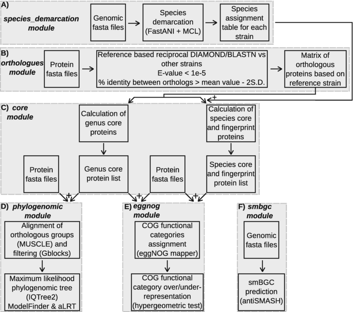

# pyPGCF

## Introduction

pyPGCF, is a python software package
that runs in the linux environment, in order to analyse bacterial genomes and perform:
i) phylogenomic analysis, ii) species demarcation, iii) identification of the core
proteins of a bacterial genus and its individual species, iv) identification of species-
specific fingerprint proteins that are found in all strains of a species and, at the same
time, are absent from all other species of the genus, v) functional annotation of the
core and fingerprint proteins with [eggNOG mapper](https://github.com/eggnogdb/eggnog-mapper), 
vi) identification of secondary metabolite
biosynthetic gene clusters (smBGCs) with [antiSMASH](https://github.com/antismash/antismash). 
This software has already
been implemented to analyse important bacterial genera (e.g. *Pseudomonas*, *Bacillus*, *Streptomyces*). 

## Workflow
The tool consists of 6 modules with each one devoted to one specific analysis as shown in the figure below.  

## Installation
pyPGCF supports Python 3.11 and 3.12. Installation is through conda, mamba or pixi.
If you don't have mamba installed just replace the word 'mamba' with 'conda'.

### Recommended: conda or mamba

Create an environment with pyPGCF and the external tools it calls:

`mamba create -n pyPGCF -c mnikolaidis -c conda-forge -c bioconda pypgcf iqtree muscle fastani mcl diamond blast fasttree`

The Python packages (pandas, scipy, biopython, openpyxl, tqdm, requests) are installed automatically.

### Using pixi

`pixi global install --path pypgcf-<version>-<build>.conda --channel conda-forge --channel bioconda --environment pypgcf`

### From source with pip

`pip install .` installs the Python dependencies only. The external tools must already be on your PATH.

### External tools

| Module | Tools |
| --- | --- |
| Species demarcation | fastANI, MCL |
| Orthologues | BLAST+ (`blastp`, `makeblastdb`), DIAMOND |
| Phylogenomic | MUSCLE, IQ-TREE, FastTree |
| eggNOG annotation | eggNOG-mapper |
| smBGC | antiSMASH |
| AMR | AMRFinderPlus |
| CAZy | dbCAN |

The conda package lists all of them as dependencies. With pip, install only the tools for the modules you use.

Notes:
1) The software should move to the bioconda channel in the near future

## Running
Details on how to run each module are available in video format in **[figshare](https://figshare.com/articles/media/pyPGCF_screencasts/22559992)**.
The help page of the software and each module is available through the --help flag: `pyPGCF --help`

### Phylogenomic CDS alignments

With `phylogenomic --input_type cds`, pyPGCF translates each coding sequence
with Biopython and aligns the translated proteins. Protein-alignment gaps are
then projected back onto the original nucleotide sequences as codon gaps
(`---`), and the resulting nucleotide alignment is written to
`Phylogenomic_tree/OGs_fasta_aln`. Input CDS lengths must be divisible by
three. The translated protein FASTA and protein alignment are temporary files
and are removed after the corresponding nucleotide alignment is written.

## Citation
Nikolaidis, M., Oliver, S.G., Amoutzias, G.D., 2024. pyPGCF: a python software for phylogenomic analysis, species demarcation, identification of core and fingerprint proteins of bacterial genomes that are important for plants. Methods in Molecular Biology.
